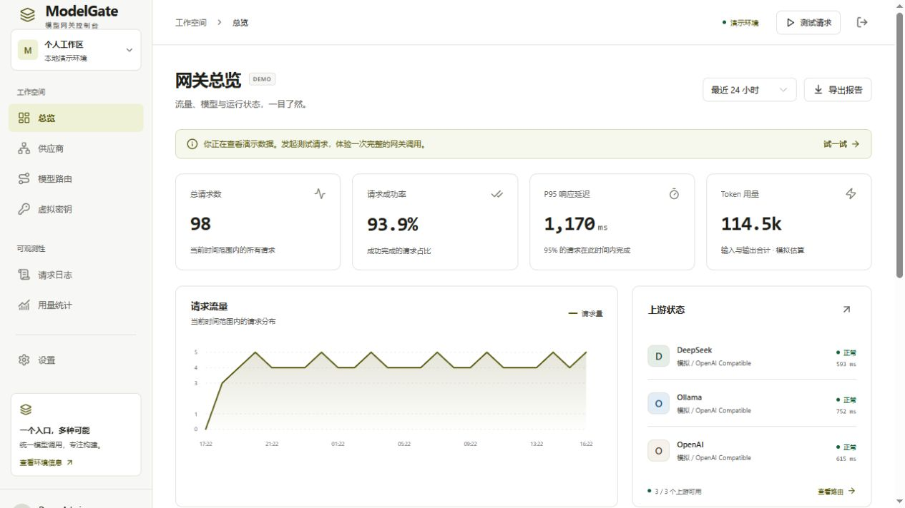

# ModelGate

面向团队的多模型 API 网关，作为 Python 后端 / AI 平台方向的开源作品集项目。

## 当前版本：可本地体验的 Demo

Vue 3 中文管理台 + FastAPI 演示后端。无需真实模型 API Key、PostgreSQL 或 Redis，即可查看流量、发起模拟请求并观察故障切换。

- **总览**：请求量、成功率、P95 延迟、Token、流量趋势与最近请求。
- **供应商与路由**：查看模型映射、启停模拟上游，验证备用渠道接管。
- **测试请求**：选择模型与输入，主动模拟首个上游故障，查看回答和尝试过程。
- **虚拟密钥**：创建、一次展示、复制和撤销；模型接口与管理接口独立鉴权。
- **日志与用量**：筛选请求、查看逐次上游尝试和 Token 汇总。
- **兼容接口**：`/v1/models`、`/v1/chat/completions`，支持 JSON 与 SSE。

所有模型回答、Token 和初始历史记录均为演示数据。新增测试请求经过本地模拟调度并写入 SQLite，刷新页面仍保留；它们不是实际厂商调用或真实账单。



## 本地启动（Windows）

需要 Python 3.11+、Node.js 20.19+ 和 npm；首次安装依赖需要网络。

```powershell
git clone https://github.com/guomingkun8-a11y/ModelGate.git
cd ModelGate
powershell -ExecutionPolicy Bypass -File .\scripts\start-demo.ps1
```

已经在本机项目目录时，直接运行启动脚本即可。

脚本创建 `.venv`、安装依赖、检查并构建前端，然后在 [http://127.0.0.1:8010](http://127.0.0.1:8010) 启动服务。按 `Ctrl+C` 停止。

已经安装并构建后，快速再次启动：

```powershell
.\scripts\start-demo.ps1 -SkipInstall -SkipBuild
```

端口占用时可以使用 `-Port 8011`。脚本不会停止其他项目服务。

## 推荐体验顺序

1. 在登录页进入演示工作区，观察初始样例流量。
2. 打开“测试请求”，发送一次普通请求，再启用故障模拟发送一次。
3. 在请求日志中查看结果、上游切换和尝试状态。
4. 禁用一个供应商并重试；查看路由是否跳过它，体验后恢复开启。
5. 创建虚拟 Key，只在创建时复制明文，再撤销并验证它无法继续调用。

默认演示登录密码是 `modelgate-demo`，默认演示虚拟 Key 是 `mg-demo-local`，仅供本机 Demo 使用。更多独立接口示例见 [demo-request.http](examples/demo-request.http)。

## 项目分类

```text
ModelGate/
├── backend/             # FastAPI、SQLite 演示状态、网关逻辑与测试
├── frontend/            # Vue 3 + TypeScript + Vite 管理台
├── docs/                # Demo 契约、长期架构与阶段清单
├── deploy/nginx/        # 生产部署阶段预留
├── scripts/             # 一键启动脚本
├── examples/            # 可执行的 HTTP 调用示例
├── loadtests/           # 正式压测阶段预留
└── .github/workflows/   # 后续 CI 预留
```

- [Demo 能力与接口](docs/DEMO.md)
- [长期目标与架构](docs/PLAN.md)
- [生产版阶段清单](docs/ROADMAP.md)
- [后端运行与验证](backend/README.md)
- [前端运行与结构](frontend/README.md)

## Demo 与生产版边界

当前使用 SQLite、进程内限制和模拟供应商，适合单进程本地演示。PostgreSQL、Redis 共享限流、真实上游适配、跨进程熔断、预算、生产登录与可靠计费仍按原计划实现。历史样例不作为压测证据，尚未声明生产性能指标。

## 验证结果

本次 Demo 已完成前端 TypeScript 检查与生产构建、8 项后端测试，以及运行中的 HTTP / SSE 冒烟验证。浏览器已验证登录、测试故障切换、逐次尝试详情、供应商启停、虚拟 Key 创建和撤销。

更多演示截图：[故障切换](docs/screenshots/demo-request.png)、[请求详情](docs/screenshots/request-details.png)。

## 开源许可

本项目使用 [MIT License](LICENSE)。
